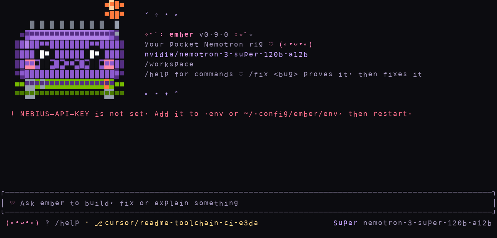

<h1 align="center">
  
</h1>

<p align="center">
  <a href="https://github.com/aneesh-pradhan/ember/actions/workflows/ci.yml"></a>
  <a href="https://github.com/aneesh-pradhan/ember/releases/latest"></a>
  <a href="LICENSE"></a>
  
  
  <a href="https://tokenfactory.nebius.com"></a>
</p>

<p align="center"><b>A terminal coding agent powered by NVIDIA Nemotron on Nebius Token Factory, written in Rust.</b></p>

Ask ember to explain a project, add a feature, or fix a failing build. It reads and searches the code, then shows the diff or the command and waits for approval before it edits a file or runs anything. `/fix` will not apply a patch until a new test fails on the current code and passes after the change.

## Prerequisites

- **git**
- **Rust 1.88 or newer**, installed with [rustup](https://rustup.rs). [`rust-toolchain.toml`](rust-toolchain.toml) pins **1.88.0**, and `Cargo.toml` sets `rust-version = "1.88"`. That is the minimum this lockfile builds with: `icu_normalizer` 2.4, `ignore` 0.4.34, and `darling_macro` 0.24 declare Rust 1.88, and several of those crates use edition 2024, which Rust 1.80 cannot compile. Current stable also builds (checked with Rust 1.100.0).
- **A [Nebius Token Factory API key](https://tokenfactory.nebius.com/project/api-keys)**, only if you want the model. Building, testing, `--help`, and `--version` do not use one. See [Run without an API key](#run-without-an-api-key).

macOS and Linux are supported (x86_64 and ARM64). The published Linux binaries are static musl builds.

## Build, test, and run

From a clean clone, with rustup on your `PATH`. Entering the directory selects the pinned 1.88.0 toolchain. `--locked` refuses to update `Cargo.lock`.

```bash
git clone https://github.com/aneesh-pradhan/ember
cd ember
cargo build --locked
cargo test --locked
cargo run --locked -- --version
cargo run --locked -- --help
```

The same checks as [CI](.github/workflows/ci.yml):

```bash
cargo fmt --all -- --check
cargo clippy --locked --all-targets -- -D warnings
cargo test --locked
```

## Run without an API key

The commands above never call a model. The full-screen UI starts with no key, prints a warning, and does not send a request until you ask it something:

```bash
cargo run --locked
```

A prompt with no key and no local server stops before the network. Captured with a clean `HOME` and no `NEBIUS_API_KEY`:

```text
$ cargo run --locked --quiet -- -p "say hi"
Error: NEBIUS_API_KEY is not set (put it in .env or ~/.config/ember/env)
```

To talk to Nemotron, copy the starter env file and set the key. To talk to a model on your own machine, point `EMBER_BASE_URL` at an OpenAI-compatible server and leave the Nebius key unset. `TAVILY_API_KEY` is optional; without it ember still runs, and `web_search` is left out.

```bash
cp .env.example .env
# set NEBIUS_API_KEY in .env, then:
cargo run --locked
```

```bash
EMBER_BASE_URL=http://127.0.0.1:8000/v1 \
EMBER_MODEL_CODER=your-local-model-id \
cargo run --locked
```

Every variable is in [`.env.example`](.env.example) and [docs/configuration.md](docs/configuration.md).

## Demo

Recorded from `target/debug/ember` in a 100×24 terminal, with no API key and an empty home directory (no `~/.config/ember/env`). The clip holds the idle screen, then `/`, which opens the command menu. `/fix` calls Nemotron, so this is the UI, not a completed fix. A still of the idle screen is [docs/demo.png](docs/demo.png).



```text
$ cargo run --locked --quiet -- --version
ember 0.9.0
```

## Contents

- [Prerequisites](#prerequisites)
- [Build, test, and run](#build-test-and-run)
- [Run without an API key](#run-without-an-api-key)
- [`/fix`: a bug proven before it's fixed](#fix-a-bug-proven-before-its-fixed)
- [How it uses Nemotron](#how-it-uses-nemotron-on-nebius-token-factory)
- [Install](#install)
- [Use](#use)
- [Configuration](docs/configuration.md) and [running on your own hardware](docs/configuration.md#run-nemotron-on-your-own-hardware)
- [Architecture](#architecture)

## `/fix`: a bug proven before it's fixed

`/fix` never hands you a patch it hasn't proven:

```
/fix Invoice totals are a cent short when tax lands on a half cent
```

1. **Investigate.** Nemotron Super explores the code with read-only tools and reports the root cause.
2. **Reproduce.** It writes a new test that must **fail on your current code**. A Nemotron Nano judge rejects
   tests that fail for the wrong reason (import errors, typos, asserting something unrelated). If ember can't
   reproduce the bug, it stops and tells you so instead of guessing.
3. **Plan.** Nemotron Ultra proposes several genuinely different fix strategies.
4. **Branch.** Each strategy runs in its own **git worktree**, in parallel, with its own patching loop. Test files
   are read-only inside a branch, so a fix can't "pass" by weakening the test.
5. **Verify.** A branch wins only if the reproduction test passes **and** the full test suite has no new failures
   compared with a baseline run.
6. **Review & apply.** Ultra picks the best passing candidate and explains why. You see the diff (fix +
   regression test) and decide whether to apply it to your working tree.

Your working tree is never touched until you approve. Uncommitted changes are included in the experiment through
`git stash create`, which snapshots them without modifying anything.

## How it uses Nemotron on Nebius Token Factory

Every model call goes to Token Factory's OpenAI-compatible API, with streaming and native tool calling.
ember routes each kind of work to the smallest Nemotron model that does it well:

| Tier | Default model | Used for |
|---|---|---|
| **Nano** | `nvidia/NVIDIA-Nemotron-3-Nano-30B-A3B` | `/fix` judgements: does this failing test really reproduce the bug? did the suite regress? |
| **Super** | `nvidia/nemotron-3-super-120b-a12b` | The interactive agent; `/fix` investigation, test writing, and every branch's patching loop |
| **Ultra** | `nvidia/Nemotron-3-Ultra-550b-a55b` | `/fix` strategy planning and choosing between passing candidates; `/review` |
| **Super VL** | `nvidia/Nemotron-3.5-Super-VL` | ember's eyes: reads screenshots and diagrams you attach, and images the agent opens with `view_image` |

Switch the interactive model at any time with `/model nano|super|ultra` (or any model id from `/models`), and its
reasoning with `/think on|low|off` (or `--think`). Nemotron's reasoning is streamed live in the UI and kept out of
the transcript.

ember is tuned for these models on Token Factory: it turns reasoning off for mechanical drafting, batches file
reads into single tool calls, keeps the prompt prefix stable so repeat requests hit the cache, and sends Super's
reasoning back between steps of a task. On ember's coding benchmark, Super with kept reasoning passed 14 of 15
runs at 8.7 s and $0.0034 per task. The measurements and benchmark are in [docs/tuning.md](docs/tuning.md).

## Install

ember runs on **macOS** (Apple Silicon and Intel) and **Linux** (x86_64 and ARM64, any distribution).
You need `git`, plus a [Nebius Token Factory API key](https://tokenfactory.nebius.com/project/api-keys).

**1. Install** (macOS or Linux):

```bash
curl -fsSL https://raw.githubusercontent.com/aneesh-pradhan/ember/main/install.sh | sh
```

The installer downloads the matching binary from [Releases](https://github.com/aneesh-pradhan/ember/releases),
verifies its SHA-256 checksum, and installs it to `~/.local/bin`.

**2. Add `~/.local/bin` to your PATH** if the installer says it's missing:

```bash
echo 'export PATH="$HOME/.local/bin:$PATH"' >> ~/.zshrc && source ~/.zshrc   # macOS (zsh)
echo 'export PATH="$HOME/.local/bin:$PATH"' >> ~/.bashrc && source ~/.bashrc # Linux (bash)
```

**3. Add your API key:**

```bash
(umask 077; mkdir -p ~/.config/ember && printf 'NEBIUS_API_KEY=%s\n' 'your-key' > ~/.config/ember/env)
```

Then run `ember` inside any project.

### Platform notes

- **macOS:** `git` comes with the Xcode Command Line Tools (`xcode-select --install`). Terminal.app may not show
  24-bit color, so ember switches to a 256-color palette there. For the best colors use iTerm2, Ghostty, WezTerm,
  Kitty or the VS Code terminal; set `EMBER_COLORS=256` or `EMBER_COLORS=truecolor` to override.
- **macOS browser downloads:** if you download a release archive in a browser instead of using the installer,
  clear the quarantine flag with `xattr -d com.apple.quarantine ./ember`.
- **Linux:** the builds are fully static (musl), so they work on any distribution.

### Build from source

Install Rust 1.88 or newer with [rustup](https://rustup.rs). A clone already pins 1.88.0; the commands are in [Build, test, and run](#build-test-and-run). To install a release-profile binary onto `PATH` from the git repo:

```bash
cargo install --locked --git https://github.com/aneesh-pradhan/ember
```

### Installer options, updating and uninstalling

- `EMBER_INSTALL_DIR=/some/dir` installs elsewhere; `EMBER_VERSION=vX.Y.Z` pins a release.
- **Update:** run the same one-liner again. **Uninstall:** `rm ~/.local/bin/ember`.
- Saved conversations live in `~/.local/share/ember` on Linux and `~/Library/Application Support/ember` on macOS.

## Use

```bash
cd your-project
ember                              # interactive session
ember "why does the build fail?"   # start with a prompt
ember -c                           # continue the last conversation in this directory
ember --plan                       # start in plan mode
ember -p "summarize src/"          # print mode: answer and exit (edits/commands denied unless --yes)
ember -p -c "keep going"           # print mode, continuing the last conversation here
ember --max-steps 150 -p --yes "…" # allow more model calls per turn (default 80)
ember --model ultra                # pick the model tier
```

### In the prompt

| Input | |
|---|---|
| `/` | Command menu: type to filter, ↑/↓ to choose, Tab or Enter to complete |
| `@path` | Attach a file (or image) to your message; a fuzzy file picker pops up as you type, Esc closes it |
| `!command` | Run a shell command yourself; its output joins the conversation |
| Shift+Tab | Cycle modes: **ask** before edits → **auto-accept** → **plan** (read-only, ends in a plan) |
| Esc | Interrupt ember (or clear the input) |
| Ctrl+T | Show the task list |
| Alt+Enter / Ctrl+J | New line |

ember runs full screen: the conversation scrolls above a prompt box pinned to the bottom. Scroll back with the
mouse wheel, PgUp/PgDn or Shift+↑/↓, and jump back to live output with Ctrl+End. Permission prompts appear as a
panel in place of the prompt: pick with ↑/↓ and Enter, or press 1-3 (or y/a/n). Because ember uses the mouse for
scrolling, select text with Shift-drag (Option-drag in iTerm2), or set `EMBER_MOUSE=off` to keep normal selection.

For multi-step work ember keeps a live **task list**, and the status bar shows how full the **context window**
is. Near the limit ember compacts the conversation automatically. When a command needs approval, "always" applies
to that command family (e.g. all `cargo test` runs), never to arbitrary shell. Conversations are saved
automatically, so you can pick them up later.

### Commands

| Command | |
|---|---|
| `/fix <bug or GitHub issue URL>` | Reproduce with a failing test, fix in parallel worktrees, verify, apply on approval |
| `/review` | Nemotron Ultra reviews your uncommitted changes, most severe findings first |
| `/commit [note]` | Draft a commit message from your changes; stage and commit only after you approve |
| `/branch <description>` | Create and switch to a well-named branch for the work |
| `/pr` | Draft a pull request from the branch's commits; push and open it with `gh` after you approve |
| `/resolve` | Work through merge conflicts, then run the tests |
| `/undo` | Restore every file ember changed in its last turn (shell commands aren't undone) |
| `/init` | Explore the repo and write an `AGENTS.md` for future sessions |
| `/plan`, `/auto` | Toggle plan mode / auto-accept |
| `/model [nano\|super\|ultra\|id]` | Show or switch the model; `/models` lists those on your key |
| `/think [on\|low\|off]` | Set how much Nemotron reasons before acting |
| `/theme [kawaii\|classic]` | Switch the look: pastel kawaii with sparkles and a moody mascot (default), or the original classic orange |
| `/resume [n]` | List saved conversations in this directory, or continue one. Conversations untouched for 30 days are deleted; set `EMBER_SESSION_DAYS` to change that (`0` keeps them) |
| `/compact` | Summarize the conversation so far to free up context |
| `/mcp [trust]` | Show MCP servers and their tools. `/mcp trust` starts the servers in this project's `.ember/mcp.json` |
| `/diff`, `/todos`, `/usage` | Uncommitted changes; task list; token usage per model, including prompt-cache hits |
| `/permissions` | What runs without asking. `/permissions save` keeps this session's "always" approvals for the project (stored in `~/.config/ember/permissions.json`, never in the repo); `/permissions forget` clears them |
| `/clear`, `/quit` | New conversation; exit (or Ctrl+C twice) |

ember reads project instructions from `AGENTS.md` or `EMBER.md` in the working directory.

### Images, web and tools

- **Images:** mention a screenshot with `@shot.png`, or drag an image file into the terminal. Nemotron Super VL
  describes it (transcribing any text exactly) for the coding model. The agent can also look at images in your
  repo with `view_image`.
- **Web:** the agent can read pages with `web_fetch`. Each fetch asks first, since a URL can carry anything the
  agent has read; "always" applies to that host. Set `TAVILY_API_KEY` ([tavily.com](https://tavily.com)) to also
  give it `web_search`, and to have `web_fetch` use Tavily Extract for cleaner pages.
- **MCP servers:** add stdio servers to `.ember/mcp.json` (per project) or `~/.config/ember/mcp.json`, in the usual
  format. Each tool call asks for permission (or "always" for that tool). A server runs as a command on your machine,
  so ember won't start a project's servers until you run `/mcp trust` there. It saves the trusted configuration in
  `~/.config/ember/mcp-trust.json` and asks again whenever the project's file changes:

  ```json
  {"mcpServers": {"github": {"command": "npx", "args": ["-y", "@modelcontextprotocol/server-github"],
                             "env": {"GITHUB_PERSONAL_ACCESS_TOKEN": "..."}}}}
  ```

### Custom commands

Save a prompt as Markdown in `.ember/commands/<name>.md` (shared with your team through the repo) or
`~/.config/ember/commands/<name>.md` (just for you), and it becomes `/<name>`. `$ARGUMENTS` is replaced with
whatever you type after the command, and `@file` mentions work inside it:

```markdown
---
description: Explain a file to a beginner
---
Explain $ARGUMENTS to someone new to this codebase, in five bullet points.
```

### Try `/fix` on the demo project

`examples/tinyledger` is a small invoicing library with a real rounding bug (see its `ISSUE.md`). Its tests run
with [uv](https://docs.astral.sh/uv/): `brew install uv` on macOS, or `curl -LsSf https://astral.sh/uv/install.sh | sh`
on either OS.

```bash
git clone https://github.com/aneesh-pradhan/ember && cd ember/examples/tinyledger
EMBER_TEST_CMD="uvx pytest -q" ember
/fix Invoice totals are a cent short: 2.50 with 5% tax gives tax 0.12, should be 0.13
```

## Animations

ember has a few small motions. They're cosmetic and don't change what the agent does:

- **Startup:** the banner's sparkles twinkle once, for about a second, then hold still.
- **Mascot:** at an idle prompt, the kawaii mascot's eyes blink every 2.5 to 4 seconds.
- **Working:** a sparkle spinner sits beside the status line, and the line names the step ember is on, such as "Reading files…" or "Running tests…".
- **Fix verified:** a short burst of sparkles, about half a second, when `/fix` produces a passing fix.
- **Errors:** the status line flashes the error color once.

Turn them off with `/animation off`, and back on with `/animation on`. The choice is saved to `~/.config/ember/config.toml`, which also takes these settings:

```toml
[animation]
enabled = true
speed = "normal"     # slow | normal | fast
mascot_blink = true
```

Animations stay off when stdout isn't a terminal, when `CI` or `NO_COLOR` is set, or when `EMBER_REDUCED_MOTION=1`. The working spinner that was already there keeps its existing behavior.

## Architecture

ember is one binary. The terminal UI and print mode (`-p`) share an agent loop: stream an OpenAI-compatible completion, approve the tool call, run it, repeat. `/fix` is a second pipeline on that loop. It proves the bug with a failing test, tries each strategy in its own git worktree, and applies a winner only after you approve. The file map and the request path are in [docs/architecture.md](docs/architecture.md).

## Development

CI runs `cargo fmt --all -- --check`, `cargo clippy --locked --all-targets -- -D warnings`, and `cargo test --locked` on Rust 1.88.0. Those commands, and how to run without an API key, are in [Build, test, and run](#build-test-and-run). Formatting follows [`rustfmt.toml`](rustfmt.toml).

Issues and pull requests are welcome on [GitHub](https://github.com/aneesh-pradhan/ember/issues).

## License

[MIT](LICENSE)

---

Built for the Nebius × NVIDIA Global AI Hackathon (Coding and Agentic Engineering track).
